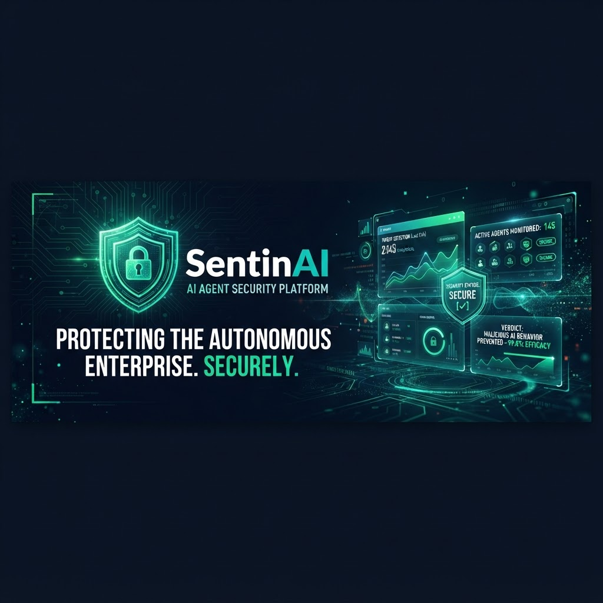
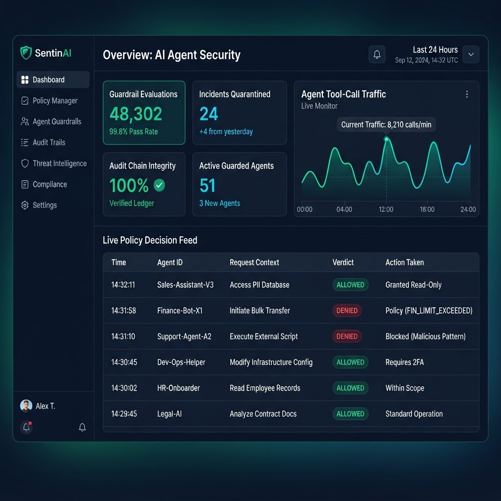
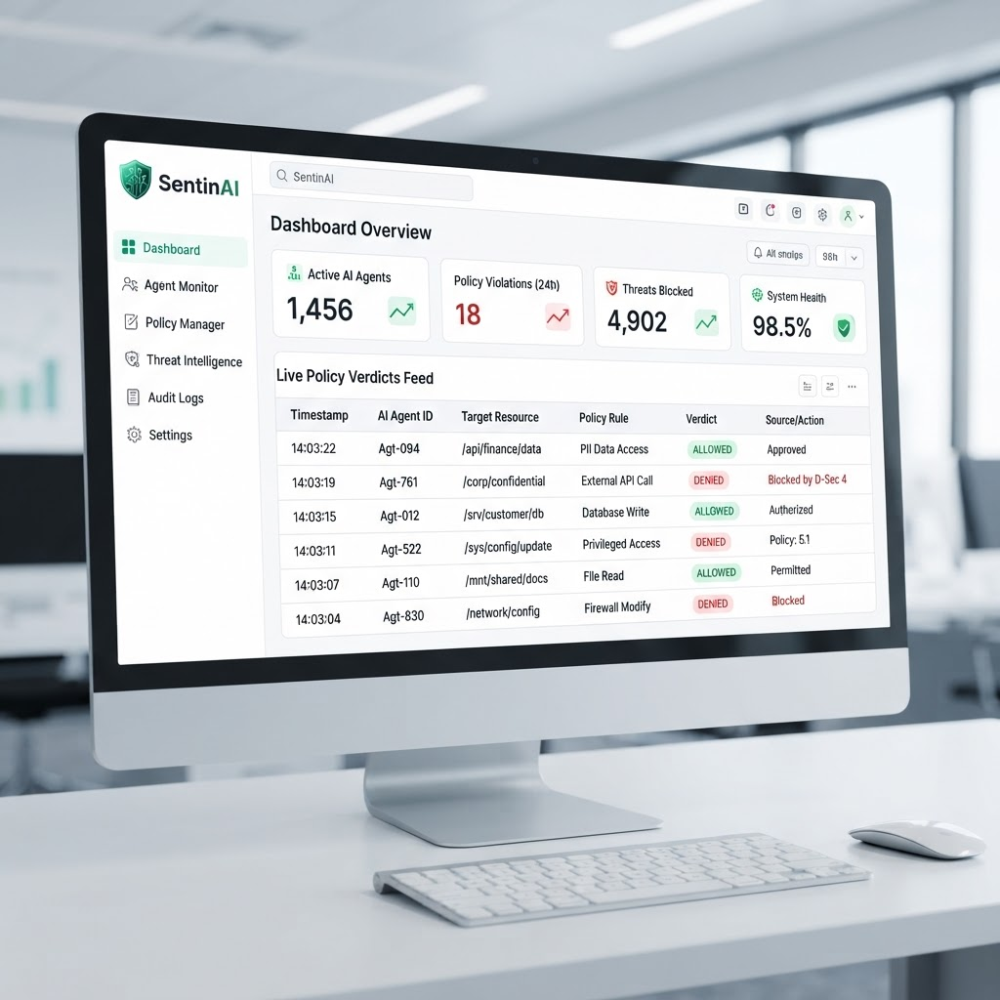
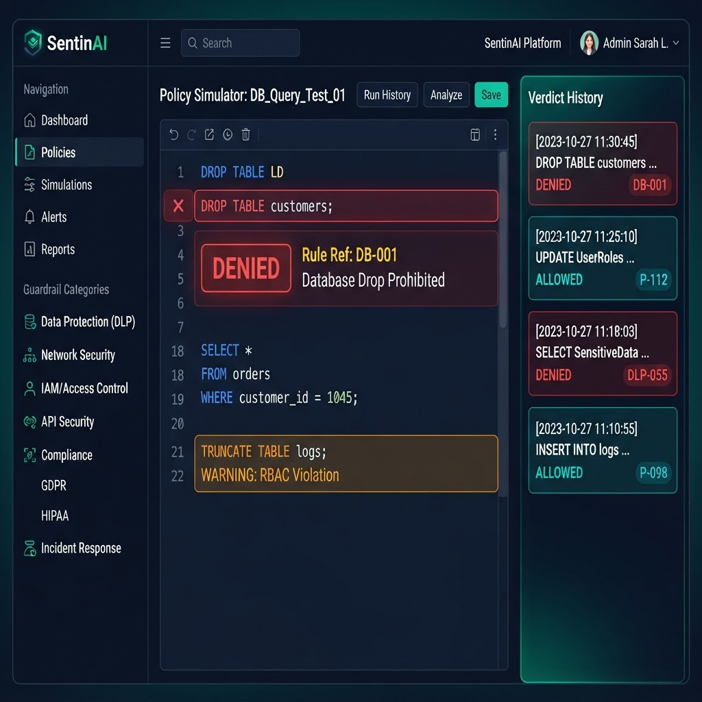
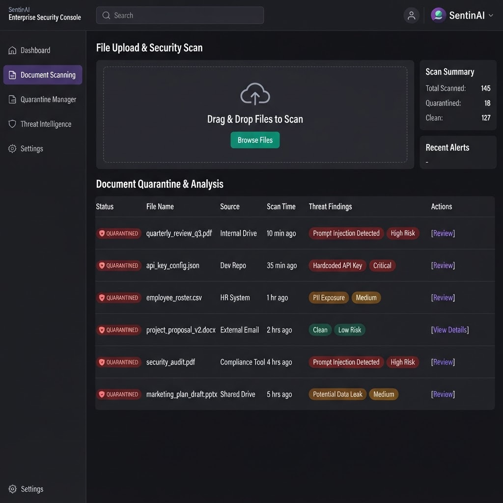
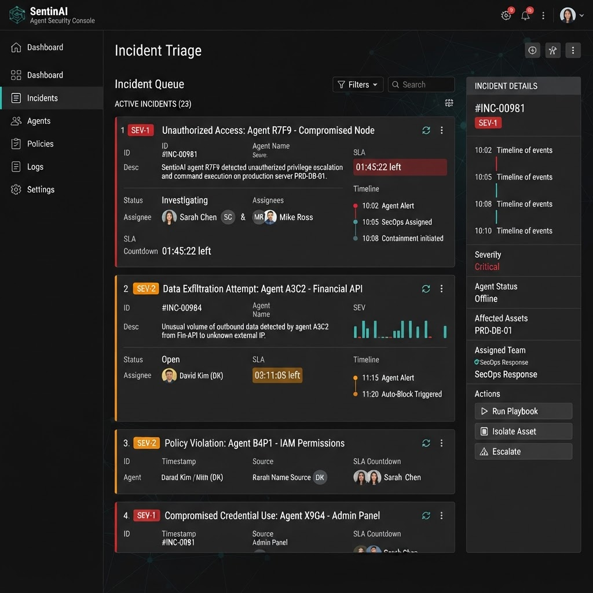
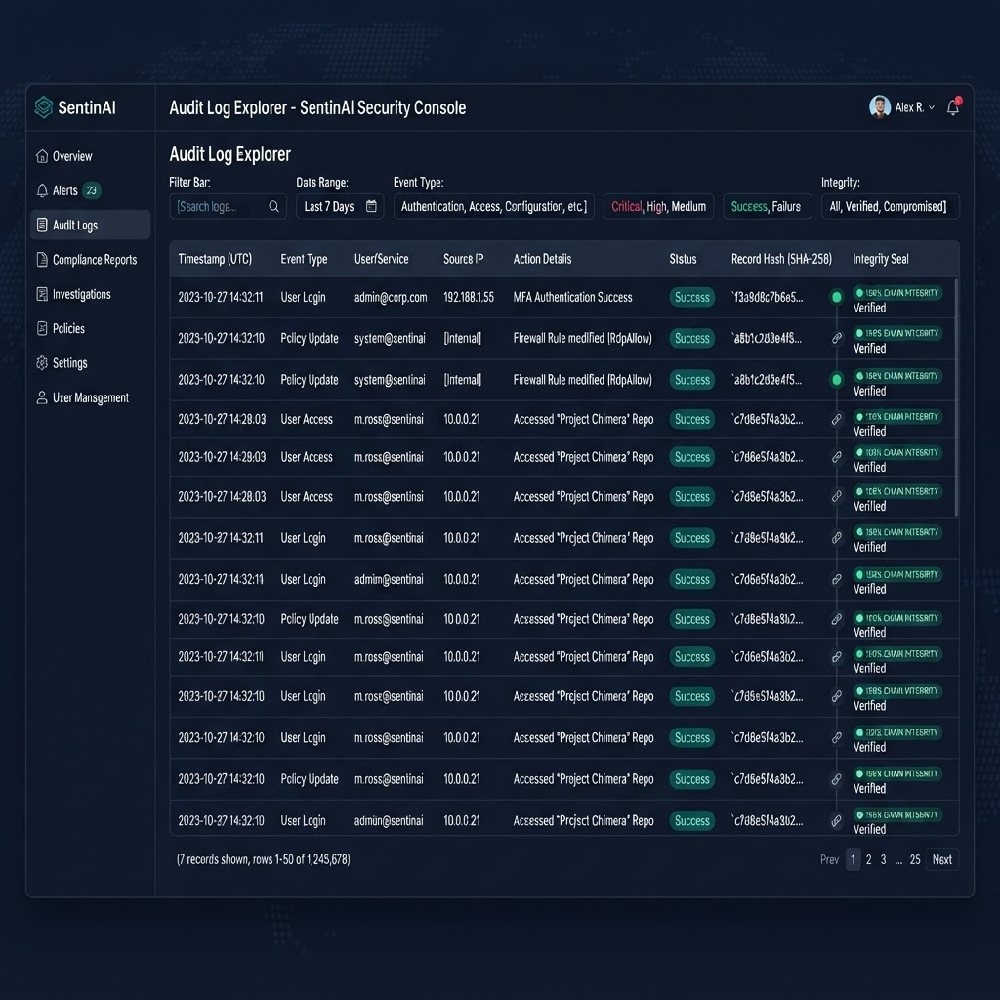
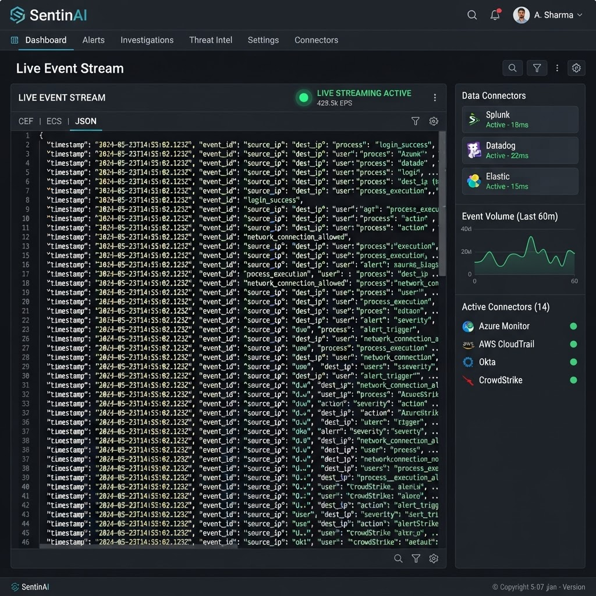
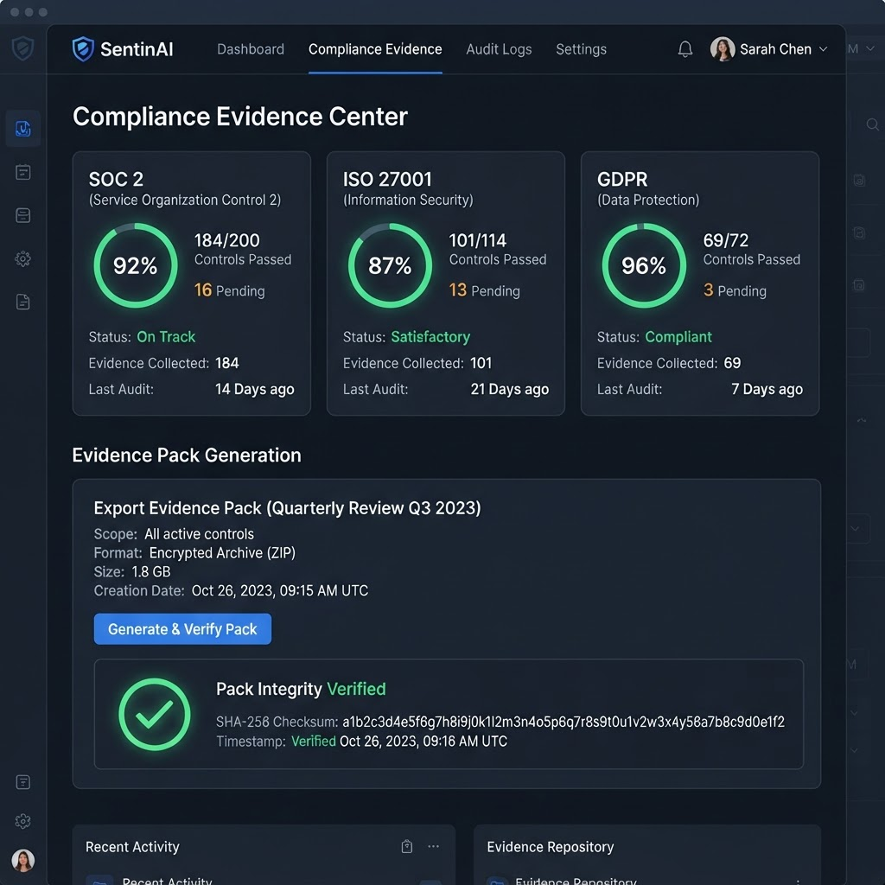
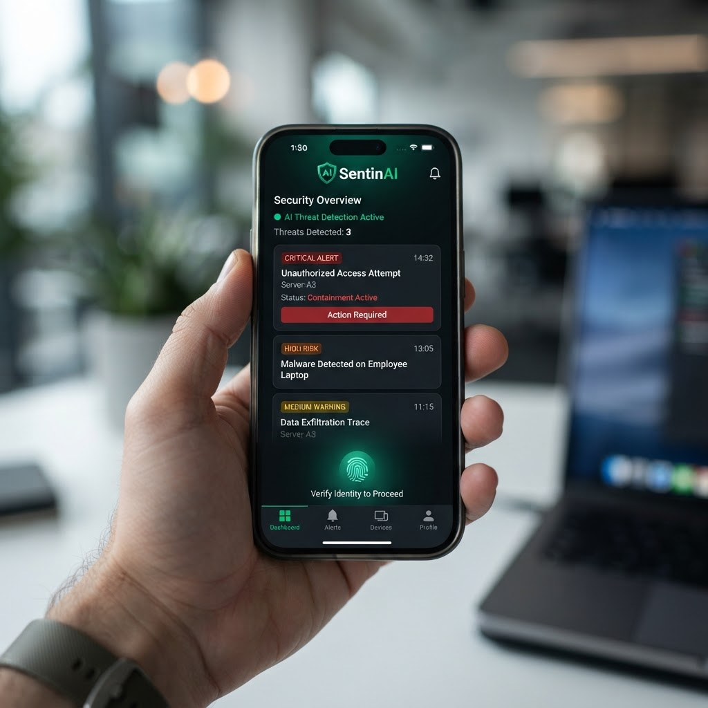

# SentinAI Guardian

[](https://antique-sentinai-shield-ops.base44.app)
[](https://github.com/malwar77/sentinai-guardian/actions)
[](#license)



**SentinAI Guardian** is a compliance-first, zero-trust governance and defense
console for autonomous AI agents. It protects corporate environments from
prompt injection, credential exfiltration, and rogue tool calls through
real-time payload inspection, automated document quarantine,
separation-of-duties workflows, and tamper-evident compliance verification.

## Links

| Resource | URL |
|---|---|
| Live app (verified production) | https://antique-sentinai-shield-ops.base44.app |
| Original prototype (frozen reference) | https://secure-sentinel-agent.lovable.app |
| Source code | [`app/`](app/) directory in this repo |

## Release artifacts

| File | Role | Contents |
|---|---|---|
| `sentinAI.zip` | **Main release** | Full source: React web app + Capacitor Android Studio project (91 files) |
| `sentinAI-reserve.zip` | Reserve | Web-only source, lighter build (23 files) |
| `grok-workspace.zip` | Legacy archive | Original workspace snapshot, kept for reference |

Download either zip from the repo root, or clone the repo and use the
[`app/`](app/) directory directly — it is the same code as `sentinAI.zip`.

## Screenshots

| Overview (dark) | Overview (light) | Guardrail Simulator |
|---|---|---|
|  |  |  |

| Document Quarantine | Incident Triage | Audit Log |
|---|---|---|
|  |  |  |

| SIEM Streaming | Compliance | Approvals |
|---|---|---|
|  |  |  |

| Mobile |
|---|
|  |

## Prerequisites

- **Node.js** v18.0.0 or higher (v20 recommended): https://nodejs.org
- **Git**: https://git-scm.com
- For Android builds: **Android Studio** with SDK 34 and JDK 17

Verify your install before starting:

```bash
node -v    # should print v18.x or higher
npm -v
git --version
```

## Install and run — Windows (PowerShell)

Open PowerShell and run:

```powershell
# 1. Clone the repository
git clone https://github.com/malwar77/sentinai-guardian.git
cd sentinai-guardian\app

# 2. Install dependencies
npm install

# 3. Start the development server
npm run dev
```

The app launches at `http://localhost:5173`. Open it in any browser.
First run: sign up with any email address — the verification code `659314`
is displayed in the dev banner on the auth screen.

To produce a production build:

```powershell
npm run build
```

The static bundle lands in `dist\` and can be served by any web server.

## Install and run — Linux (bash)

Open a terminal and run:

```bash
# 1. Install prerequisites (Debian/Ubuntu example)
sudo apt update
sudo apt install -y git curl
curl -fsSL https://deb.nodesource.com/setup_20.x | sudo -E bash -
sudo apt install -y nodejs

# 2. Clone the repository
git clone https://github.com/malwar77/sentinai-guardian.git
cd sentinai-guardian/app

# 3. Install dependencies
npm install

# 4. Start the development server
npm run dev
```

The app launches at `http://localhost:5173`.
Verification code for the first sign-up: `659314`.

Production build:

```bash
npm run build
# serve the dist/ folder with any static server, e.g.:
npx serve dist
```

## Install and run — iOS

Stock iOS does not ship a local terminal and cannot run Node.js natively,
so there are two supported routes:

**Option A — use the live app (no install):**
Open https://antique-sentinai-shield-ops.base44.app in Safari, then tap
*Share → Add to Home Screen*. The app runs as a full-screen web app with
persistence kept in device storage.

**Option B — run it from iOS via SSH (remote terminal):**
Install a terminal app with SSH support (Termius, Blink Shell, or a-Shell),
SSH into a Linux/macOS machine that has Node.js, then run the same Linux
commands from the section above:

```bash
ssh youruser@your-server
git clone https://github.com/malwar77/sentinai-guardian.git
cd sentinai-guardian/app
npm install
npm run dev -- --host
```

The `--host` flag exposes the dev server on your network, so you can open
`http://<server-lan-ip>:5173` in Safari on the iPhone.

## Install and run — Android

**Option A — Android Studio (full build):**

1. Install Android Studio (SDK 34 + JDK 17): https://developer.android.com/studio
2. Clone the repo:

```bash
git clone https://github.com/malwar77/sentinai-guardian.git
```

3. In Android Studio: *File → Open* → select `sentinai-guardian/app/android`
4. Wait for Gradle sync to finish (first sync downloads dependencies)
5. Press *Run* (▶) with an emulator or USB-connected device — the app
   installs and launches as a native APK

After changing web code, refresh the Android app:

```bash
cd sentinai-guardian/app
npm run build
npx cap sync android
```

Then re-run from Android Studio. A signed release APK is produced via
*Build → Generate Signed Bundle / APK*.

**Option B — Termux (terminal only, no Android Studio):**

```bash
pkg update && pkg install git nodejs -y
git clone https://github.com/malwar77/sentinai-guardian.git
cd sentinai-guardian/app
npm install
npm run dev -- --host
```

Open `http://127.0.0.1:5173` in Chrome on the same device.

## Editor setup (VS Code)

1. Open the `app/` folder in VS Code
2. Recommended extensions: ESLint, Tailwind CSS IntelliSense, Prettier
3. New terminal → `npm install && npm run dev`

## Application views

The `app/` implementation is built with **React 18**, **Vite**, and
**Tailwind CSS**:

| Route | View | Description |
|---|---|---|
| `/` | Overview Dashboard | Fleet health, active alerts, quarantine count, and recent events. |
| `/orchestration` | Orchestration | Endpoint routing and bulk categorization. |
| `/registry` | Model Registry | Endpoint registration, live probes, p50/p95 latency. |
| `/documents` | Quarantine & Scanning | Content-based document scanning, quarantine isolation, finding breakdown. |
| `/guardrails` | Policy Simulator | Tool-call simulation, prompt injection rules, verdict logging. |
| `/incidents` | Incident Management | SEV-1/2/3 triage, SLA clocks, resolution tracking. |
| `/sla` | SLA & Escalations | Countdown timers and escalation ladder. |
| `/approvals` | 4-Eyes Governance | Human-approval queue for escalated verdicts. |
| `/audit` | Audit Log Explorer | Tamper-evident hash-chained event history. |
| `/siem` | SIEM Streaming | Normalized event stream with JSON export. |
| `/governance` | Retention Policies | Tenant, retention, and policy ownership. |
| `/compliance` | Compliance Verifier | SOC 2 / ISO 27001 / GDPR evidence packs from live records. |

## What is verified in this implementation

1. **Real guardrail engine** (`app/src/lib/engine.js`) — content-based verdicts:
   `DROP TABLE customers;` → **DENIED** (DB-001), benign `SELECT` → **ALLOWED**
   (DB-000), bulk exports (LIMIT 50000) → **HUMAN APPROVAL** (DB-020), prompt
   injection → **DENIED** (PR-001). Unrecognized statements escalate, never
   silently pass.
2. **Persistence** (`app/src/lib/db.js`) — every evaluation fans out to
   PolicyDecision, SIEM event, and AuditLog records; data survives reload.
3. **Accurate metrics** — Overview numbers are computed from the records.
   Nothing is hardcoded.
4. **Tamper-evident audit chain** — each audit record hashes the previous
   record; the sidebar shows live chain integrity.
5. **Auth gate** — signup → email-code verification → session, mirroring the
   production app.

## Deployment

- **Production (Base44):** the verified live app runs at
  https://antique-sentinai-shield-ops.base44.app with persistence,
  authentication, and the corrected guardrail engine.
- **Self-hosting (Vercel / Netlify / Cloudflare Pages):** run
  `npm run build` in `app/`, deploy the generated `dist/` directory, and
  configure SPA rewrite rules to redirect all traffic to `index.html`.
- **Android:** the `app/android/` Capacitor project builds a native APK via
  Android Studio.

## Security & Compliance Posture

- **Zero Untrusted Tool Execution**: intercepts tool-calling interfaces prior to model execution.
- **Tamper-Evident Logs**: audit records are hash-chained; tampering flips the integrity indicator.
- **Four-Eyes Gating**: escalated verdicts require independent human approval.
- **Compliance-First Positioning**: SOC 2, ISO 27001, and GDPR evidence packs generated from live records.

## License

MIT License. Designed and engineered for the AI systems and cybersecurity community.
